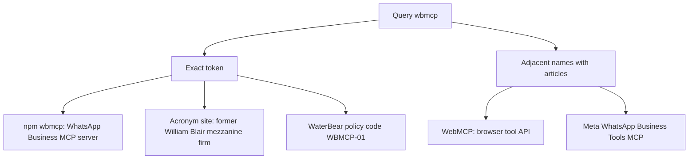

# What WBMCP refers to

**WBMCP** is the name of an independent MCP server and TypeScript SDK for Meta's WhatsApp Business Cloud API. It is the npm package `wbmcp`, repository [saravanaspar/WBMCP](https://github.com/saravanaspar/WBMCP), latest version **0.1.3** (2 July 2026). Its own CLI help line is "WBMCP - WhatsApp Business MCP server." No independent article, paper, or Hacker News story about that package was found. The articles a loose search returns are about **WebMCP**, a separate browser API, and about **Meta's WhatsApp Business Tools MCP**, which Meta does not call WBMCP.

Checked 2026-10-12.

## Context

The question is an identity and source census: what the exact token `wbmcp` / `WBMCP` refers to, which pages are primary, and which are articles. The workspace has no local matches. Freshness matters because the package, Meta's official server, and the WebMCP draft all moved in 2026.

Evidence that would change the answer: a Meta or MCP-registry page that uses the exact token for this package; a W3C or Chrome page that spells the browser API `WBMCP`; or the firm Merit Capital using `WBMCP` on its own site.

## Directions

| Direction | Conclusion and why | Sources and relevant dates | Quality, objections, and uncertainty |
|---|---|---|---|
| Exact-name software | Confirmed. `wbmcp` is one maintainer's WhatsApp Business Cloud API MCP server and SDK. The repo lists 61 implemented tools and says it is independent of Meta. | npm registry and GitHub, created 4 June 2026; 0.1.3 on 2 July 2026 | Primary and consistent. Obscure: 2 stars, 0 forks, 876 npm downloads through 12 Oct 2026. "Production-ready" is the author's wording. |
| Articles about that package | None found. The only public write-ups are the README and Reddit posts on 27 June 2026 by someone who linked this repo and described it as their project. One reply exists. | PullPush archive of Reddit; HN and arXiv exact search returned 0 | Strong negative result on open indexes. An unindexed page could still exist. The launch post claims receive support that the current tool list does not include. |
| Names one letter away | WebMCP is a W3C Community Group browser API with a real article trail. Meta's official server is "WhatsApp Business Tools MCP." Neither page uses the token WBMCP. | WebMCP draft 9 Oct 2026; Chrome blog 10 Feb 2026; Meta post 15 Sep 2026 | These are the pages with articles. They are different projects. PromptArmor's site-count is that firm's claim. |
| Older exact-string leftovers | A rare acronym-site expansion names a former Chicago mezzanine firm. A UK college policy uses the document code WBMCP-01. | PitchBook and Mergr on the former name; WaterBear PDF, July 2025 | Real strings, dormant meanings. AcronymFinder cites nothing. The current firm site pages inspected do not use the acronym. |

### Exact-name software

The npm registry record and the GitHub README agree. `wbmcp` 0.1.3 is a public package by maintainer `saravanaspar` (SaravanaKumar N, Chennai). Binaries are `wbmcp` and `whatsapp-business-mcp`. It depends on `@modelcontextprotocol/sdk` and `zod`, requires Node 20 or newer, and also exports `wbmcp/sdk`. The GitHub repo was created 4 June 2026, has 13 commits, 2 stars, 0 forks, and its last push was 2 July 2026. The license file is MIT, copyright 2026 SaravanaKumar N. `package.json` has no `license` field, so the npm registry's license metadata is empty even though GitHub detects MIT from the file.

`docs/TOOLS.md` states a tool count of 61. A count of the implemented table on 12 October 2026 is 61 names, from `whatsapp_health_check` through `whatsapp_get_prompt_snippets`. The tests that expect that list were not executed. `whatsapp_upload_media` is listed under "Not Yet Implemented," along with media download, webhook hosting, inbound messages, campaigns, CRM, and delivery or read lookup.

The README says the server calls the official WhatsApp Business Cloud API. It says it does not provide WhatsApp Web or Business-app login, an inbox, conversation storage, webhook hosting, or a way around Meta's policy limits. Mutating tools stay off unless `MCP_ENABLE_DANGEROUS_TOOLS=true`. Default transport is local stdio. The README disclaimer says the project is not affiliated with, endorsed by, or sponsored by Meta, WhatsApp, or the AI client vendors it mentions. `docs/SECURITY.md` says not to use it with personal WhatsApp, QR login, or unofficial clients. Snyk's package page lists no direct vulnerabilities for 0.1.0 through 0.1.3. That is a database lookup, not a code audit.

npm reports 876 downloads from 1 June 2026 through 12 October 2026, and 102 from 12 September through 11 October 2026. Those are install events, including the publisher and automated installs, not unique users. PyPI has no package named `wbmcp`.

### Articles about that package

Hacker News Algolia for the exact phrase `"WBMCP"` returned 0 hits. The arXiv API query `all:WBMCP` returned 0 results. Broad web search for the exact token returns the repository, npm, README mirrors (npm.io, Libraries.io, jsDelivr), Snyk's version table, and acronym dumps. Those mirrors repeat the README. They are one source.

The maintainer-side public posts, recovered from the PullPush archive because reddit.com did not return the thread, are:

- 27 June 2026, 13:53–13:55 UTC, user `Minimum_Notice_9521`, title "I built an open-source MCP server for WhatsApp Business API (WBMCP)," posted to r/mcp, r/modelcontextprotocol, and r/node. The r/modelcontextprotocol text links `https://github.com/saravanaspar/WBMCP`.
- 29 June 2026, 11:03 UTC, a crosspost on r/opensource.

One other person replied on 29 June 2026. `Kind-Plantain-2697` said the official Cloud API was the right choice and that real use needs inbound webhooks, retry deduplication, and 24-hour-window handling. The author replied the same day: "Not yet."

That exchange conflicts with the launch post, which says the server lets agents "send and receive" WhatsApp messages. The tool inventory through 0.1.3 still lists inbound messages and webhook hosting as not implemented. The current docs are the more specific source. The June post overclaims receive support.

### Names one letter away

**WebMCP** is the subject of the articles. The W3C Web Machine Learning Community Group draft, dated 9 October 2026, is titled WebMCP, shortname `webmcp`. Editors are Brandon Walderman (Microsoft), Khushal Sagar (Google), and Dominic Farolino (Google). The status section says it is a Community Group draft, not a W3C Standard and not on the W3C Standards Track. The abstract says the API lets web applications provide JavaScript tools to AI agents. The introduction says a page using it is like a Model Context Protocol server implemented in client-side script. A search of that draft finds `WebMCP` / `webmcp` and does not use `WBMCP`.

Chrome's own blog, "WebMCP is available for early preview," by André Cipriani Bandarra, was published 10 February 2026 and last updated that day. It describes a declarative HTML API and an imperative JavaScript API for agent actions on a site. Hacker News discussions of that work include "WebMCP is available for early preview" (360 points, 1 March 2026) and "WebMCP Proposal" (153 points, 16 February 2026). PromptArmor's article "What is WebMCP and what are the risks?" states an adoption snapshot as of 6 October 2026 and attributes 2,959 sites to webmcp.com. That count was not re-counted here. It is a vendor claim about WebMCP.

**Meta's server** is a third project. On 15 September 2026, Zoë Lieberman announced "WhatsApp Business Tools MCP." Meta's docs name the server `WhatsApp Business Tools`, endpoint `https://mcp.facebook.com/whatsapp_business_tools`, transport Streamable HTTP, authentication by Meta OAuth. Tools use the prefix `whatsapp_biz_`. The post says the release is for development and testing, and that it is rolling out gradually. Those pages do not mention `wbmcp`. WBMCP is older (4 June 2026), local, and token-based. Meta's server is newer, remote, and OAuth-based.

Other near-misses that do not use the exact token: Wildberries `wb-mcp-server` ("WB MCP Server"), the workbench package `wb-mcp`, Weights & Biases' "W&B MCP Server," `wasmcp` (WebAssembly components and MCP), and `wamcp.app` (a different WhatsApp MCP product). GitHub repository search for `WBMCP` returned three repos: the WhatsApp package, `KalyaniYara/Wbmcp-test` (description "WEBmcp testing," created 7 July 2026, 0 stars), and `farmerjeffrey354/wbmcpf`, a different token.

### Older exact-string leftovers

AcronymFinder defines WBMCP as "William Blair Mezzanine Capital Partners (Chicago, IL)" and says the definition appears very rarely. It cites no document. PitchBook lists Merit Capital Partners, Chicago, founded 1993, as formerly known as William Blair Mezzanine Capital Partners. Mergr says William Blair Mezzanine Capital became independent in 2004 as Merit Capital Partners. Merit overview pages inspected for this report, including a 2022 firm PDF, do not use the acronym. William Blair Capital Partners, which became Chicago Growth Partners, is a different former name (WBCP).

WaterBear, a college of Falmouth University, published "Managing Conduct Policy" in July 2025 with document code `WBMCP-01`. The header uses that code. It does not define a product or an organization named WBMCP.

## Comparison

The exact token and the article trail point at different things. The package identity is direct: registry JSON, the GitHub README, `docs/TOOLS.md`, the CLI help string, and the license file were all read. Stars, dates, and download totals come from the GitHub and npm APIs on 12 October 2026.

The article search is a negative result with one archive exception. README mirrors were collapsed into the repository. WebMCP coverage was kept because it is what search and Hacker News return for this spelling, and because dropping it would hide the only real articles. It does not redefine WBMCP.

Meta's September announcement matters as the official WhatsApp MCP product a reader may have meant. It uses another name, another endpoint, and OAuth. The README's independence disclaimer matches that split.

The finance acronym and the college document code are exact-string hits with no current product behind them. They lose to the package on recency and on a living primary source. They would outrank the package if Merit or WaterBear used `WBMCP` as their own name. The pages checked do not.

The June Reddit post was revised downward by the author's own next-day reply and by the July tool list. Receive support stays out of the description of the package.

## Recommendation

Use **WBMCP** for the npm package `wbmcp`: an unofficial, single-maintainer MCP server and SDK for the WhatsApp Business Cloud API, version 0.1.3, 61 documented tools, MIT license file, local stdio by default. There is no article body of work about it.

For reading, use three piles and keep the names apart:

1. Package primary sources, listed below. Start with the README and `docs/TOOLS.md`.
2. WebMCP articles and the 9 October 2026 draft, if the intended subject is websites exposing tools to browser agents.
3. Meta's 15 September 2026 announcement and the WhatsApp Business Tools MCP docs, if the intended subject is an official WhatsApp MCP server.

The package is the best-supported meaning of the exact string. It is a weak choice as a production dependency: pre-1.0, one author, last push 2 July 2026, a few hundred recorded downloads, and no outside review.

## Dissent

The strongest objection is that nobody but the author uses the name. Two GitHub stars and a self-posted Reddit thread do not make a term. A person who asked for articles almost certainly wanted WebMCP, which has the Chrome post, the community-group draft, Hacker News threads, and security write-ups. That reading wins if the goal is the literature rather than the exact token.

It would become the better answer if the user meant the browser API, or if a Chrome or W3C page spelled that API `WBMCP`. The 9 October 2026 draft does not. The npm package would become the settled public meaning only if a party other than the author, such as Meta or a security write-up, used the exact token for it.

## Limits

As-of date for live checks: 12 October 2026.

`www.npmjs.com/package/wbmcp` returned a Cloudflare interstitial. Identity comes from `registry.npmjs.org/wbmcp`, which matches the GitHub tree. The official MCP registry request timed out with no body, so a registry listing is unconfirmed. Semantic Scholar was rate-limited and was not retried. A Google Scholar snippet mentioning "WBMCP" in a Tigard enrollment forecast was not opened, so that sentence is unconfirmed and is not treated as a source. GitHub code search required authentication and was not available. Live reddit.com did not return the thread; the posts and the one reply are from the PullPush archive. The 61-tool figure is the inventory file, not a test run. npm download totals are install events. Snyk's clean listing is not an audit. PromptArmor's figure of 2,959 WebMCP sites is that article's citation of webmcp.com.

## Next action

- If the target is this package, read [the README](https://github.com/saravanaspar/WBMCP) and [docs/TOOLS.md](https://github.com/saravanaspar/WBMCP/blob/main/docs/TOOLS.md), and treat receive, webhooks, and "production-ready" as undocumented or deferred.
- If the target is the browser API, read the [WebMCP draft](https://webmachinelearning.github.io/webmcp) and [Chrome's 10 February 2026 post](https://developer.chrome.com/blog/webmcp-epp).
- If the target is an official WhatsApp integration, read [Meta's docs](https://developers.facebook.com/documentation/mcp/whatsapp-business-tools-mcp). That server is not WBMCP.

## Sources

- https://registry.npmjs.org/wbmcp — package `wbmcp` 0.1.3, created 2026-06-04, maintainer `saravanaspar`, bins `wbmcp` and `whatsapp-business-mcp`. Registry JSON fetched 2026-10-12. The npm HTML page was blocked.
- https://api.npmjs.org/downloads/point/2026-06-01:2026-10-12/wbmcp — 876 downloads in that window. Install events, not users.
- https://api.npmjs.org/downloads/point/last-month/wbmcp — 102 downloads, 2026-09-12 through 2026-10-11.
- https://github.com/saravanaspar/WBMCP — README: independent WhatsApp Business Cloud API MCP server and SDK; 61 tools claimed; explicit non-goals; not affiliated with Meta. Fetched 2026-10-12.
- https://api.github.com/repos/saravanaspar/WBMCP — created 2026-06-04, pushed 2026-07-02, 2 stars, 0 forks, MIT, TypeScript. Fetched 2026-10-12.
- https://raw.githubusercontent.com/saravanaspar/WBMCP/main/src/cli/help.ts — "WBMCP - WhatsApp Business MCP server." Fetched 2026-10-12.
- https://raw.githubusercontent.com/saravanaspar/WBMCP/main/docs/TOOLS.md — 61 implemented tools counted 2026-10-12; upload, inbound, and webhooks listed as not implemented.
- https://raw.githubusercontent.com/saravanaspar/WBMCP/main/docs/SECURITY.md — pre-1.0; official Cloud API only; secrets stay off the client. Fetched 2026-10-12.
- https://raw.githubusercontent.com/saravanaspar/WBMCP/main/LICENSE — MIT, Copyright 2026 SaravanaKumar N.
- https://raw.githubusercontent.com/saravanaspar/WBMCP/main/CHANGELOG.md — 0.1.0 initial; 0.1.2 on 2026-06-29; 0.1.3 on 2026-07-02.
- https://security.snyk.io/package/npm/wbmcp — no direct vulnerabilities listed for 0.1.0–0.1.3. Database page, not an audit.
- https://www.reddit.com/r/modelcontextprotocol/comments/1uh3eni/i_built_an_opensource_mcp_server_for_whatsapp/ — author post, 2026-06-27, recovered via PullPush. Claims send and receive; links the GitHub repo.
- https://api.pullpush.io/reddit/search/comment/?link_id=1uh3eni — 2026-06-29 reply that inbound webhooks were the hard part; author answered "Not yet."
- https://hn.algolia.com/api/v1/search?query=%22WBMCP%22 — 0 exact hits, checked 2026-10-12. Unquoted search returns WebMCP threads only.
- https://export.arxiv.org/api/query?search_query=all:WBMCP — 0 results, feed updated 2026-10-12.
- https://webmachinelearning.github.io/webmcp — WebMCP Draft Community Group Report, 9 October 2026. Different name.
- https://developer.chrome.com/blog/webmcp-epp — Chrome, "WebMCP is available for early preview," André Cipriani Bandarra, published and last updated 2026-02-10.
- https://www.promptarmor.com/resources/what-is-webmcp-and-what-are-the-risks — WebMCP risk article; adoption snapshot stated as of 2026-10-06. The 2,959-site figure is the article's citation of webmcp.com.
- https://developers.facebook.com/blog/post/2026/09/15/whatsapp-business-messaging-mcp-ai-agent/ — Zoë Lieberman, 15 September 2026, announcing WhatsApp Business Tools MCP. Does not name WBMCP.
- https://developers.facebook.com/documentation/mcp/whatsapp-business-tools-mcp — official server, endpoint `https://mcp.facebook.com/whatsapp_business_tools`, OAuth, beta. Fetched 2026-10-12.
- https://www.acronymfinder.com/William-Blair-Mezzanine-Capital-Partners-(Chicago%2c-IL)-(WBMCP).html — rare, uncited acronym expansion.
- https://pitchbook.com/profiles/investor/10485-64 — Merit Capital Partners, formerly William Blair Mezzanine Capital Partners. Secondary database.
- https://mergr.com/investor/merit-capital-partners — says the firm became independent in 2004. Secondary database.
- https://waterbear.org.uk/wp-content/uploads/2025/07/Managing-Conduct-Policy-WBMCP-01-2025.pdf — Managing Conduct Policy, code WBMCP-01, July 2025.
- https://github.com/WebMCP-org/mcp-b — MCP-B / WebMCP ecosystem. Different name. Not a WBMCP source.
- https://github.com/DeviceIngineering/wb-mcp-server — "WB MCP Server" for Wildberries. Does not use the token WBMCP.
- https://wamcp.app/ — WAMCP, a different WhatsApp MCP product.
