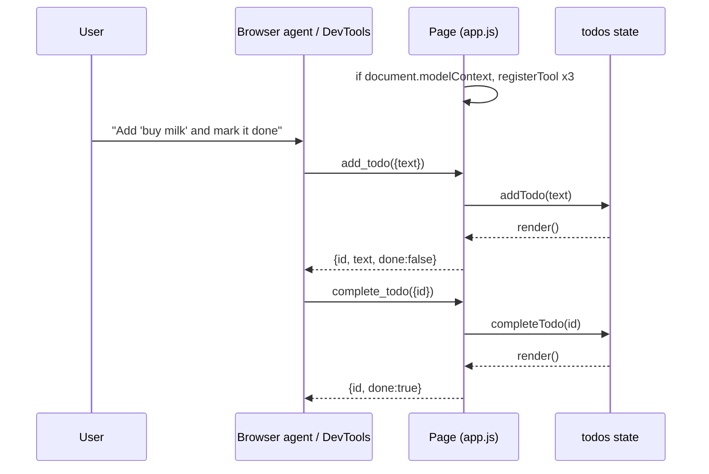

# Simple WebMCP to-do page

We propose a static to-do page, with no build step and no dependencies, that registers three tools through the imperative WebMCP API (`document.modelContext.registerTool`): `list_todos`, `add_todo`, and `complete_todo`. An agent in the browser calls these tools instead of clicking the UI. The page still works as a normal to-do app in browsers without WebMCP.

## Summary

- **Decision:** one HTML file and one ES module, served from `localhost`. All three tools read and write the same in-memory state that drives the UI, so a tool call is visible on the page right away.
- **Practical effect:** this is the smallest working example of the full loop: a page registers tools, an agent discovers them, a tool runs, and the UI updates. It can be checked in Chrome DevTools without an AI key.
- **Why the imperative API:** it is the core of the spec, and it covers both reads and writes. It also returns structured results. The declarative `<form toolname>` API only fits form submissions.

## Problem and context

Without WebMCP, agents operate pages by taking screenshots, scraping the DOM, and simulating clicks. That takes several steps and breaks easily. WebMCP lets a page publish "tools": JavaScript functions with a description and a JSON Schema for their inputs. Agents can call these tools directly ([explainer](https://github.com/webmachinelearning/webmcp/blob/main/README.md)).

Status as of 2026-10-12:

- **Spec:** a draft from the W3C Web Machine Learning Community Group. The entry point is `document.modelContext`, available only in secure contexts ([spec IDL, `partial interface Document`](https://webmachinelearning.github.io/webmcp/)). Older articles use `navigator.modelContext`, which is outdated.
- **Browsers:** Chrome has an Origin Trial from version 149, and Edge from version 150. For local development, Chrome has the flag `chrome://flags/#enable-webmcp-testing` ([Chrome docs](https://developer.chrome.com/docs/ai/webmcp), [implementation status](https://github.com/webmachinelearning/webmcp/blob/main/implementation-status.md)). Firefox and Safari have no implementation.
- **Testing:** the Chrome DevTools **Application → WebMCP** pane lists registered tools and logs every call. It can also run a tool by hand, so no agent is needed to test ([DevTools docs](https://developer.chrome.com/docs/devtools/application/webmcp)).

This workspace contains workshop material only (`WORKSHOP.md`, `workshop/`, `octocode-workshop/`). It has no app code to extend, so the demo is a new, self-contained folder.

## Goals and scope

Goals:

- The page registers exactly three tools with valid JSON Schemas and accurate annotations.
- A tool call and a user click produce the same state change and the same UI update.
- The page detects WebMCP support. When the API is missing, the page still works and shows a "WebMCP unavailable" notice.

Out of scope: persistence (no `localStorage` or backend), frameworks, the declarative form API, cross-origin iframes or `exposedTo`, Origin Trial tokens, and building a custom agent.

## Proposed design



**Files (proposed):**

| File | Contents |
|---|---|
| `webmcp-todo/index.html` | Form, list, status line, and `<script type="module" src="app.js">` |
| `webmcp-todo/app.js` | State, `render()`, UI handlers, and tool registration |

**State:** `const todos = []` holds items shaped `{ id: number, text: string, done: boolean }`. Only `addTodo(text)` and `completeTodo(id)` change it. The form handler and the tools both call these functions, then call `render()`. Because both paths share this code, the UI and the agent cannot get out of sync.

**Tools:**

| Tool | Input schema | Returns | Annotations |
|---|---|---|---|
| `list_todos` | `{type:"object", properties:{}}` | JSON string of `todos` | `readOnlyHint: true` |
| `add_todo` | `{text: string, minLength 1, maxLength 200}`, required | the new item | `untrustedContentHint: true` (the text is user content that will be returned to agents later) |
| `complete_todo` | `{id: integer}`, required | the updated item | none |

Registration sketch:

```js
if ('modelContext' in document) {
  await document.modelContext.registerTool({
    name: 'add_todo',
    description: 'Add an item to the visible to-do list. Returns the new item with its id.',
    inputSchema: {
      type: 'object',
      properties: { text: { type: 'string', minLength: 1, maxLength: 200 } },
      required: ['text'],
    },
    annotations: { untrustedContentHint: true },
    execute: async ({ text }) => JSON.stringify(addTodo(text)),
  });
  // list_todos and complete_todo follow the same pattern
} else {
  status.textContent = 'WebMCP unavailable: the page works, agents cannot call tools.';
}
```

The API shapes come from the [imperative API guide](https://developer.chrome.com/docs/ai/webmcp/imperative-api) and the spec's `ModelContextTool` and `ToolAnnotations` dictionaries.

**Failure handling:** `execute` validates its inputs again instead of relying only on the schema. For an empty or overlong text, or an unknown `id`, it throws an `Error` with a clear message. The spec reports a rejected `execute` to the caller as `OperationError` ("tool rejected"). Text is always written with `textContent`, never `innerHTML`, so a call from an agent cannot inject markup.

**Security:** none of the tools is consequential (nothing is deleted, paid for, or sent anywhere), so `consequentialHint` stays `false`. The default `tools` permissions policy (`self`) already blocks registration in cross-origin iframes.

**Serving:** `npx serve webmcp-todo` (the workshop already uses `npx serve`). Browsers treat `http://localhost` as a secure context, so `document.modelContext` is available there once the Chrome flag is on.

## Alternatives and rationale

| Option | Fit | Why not chosen |
|---|---|---|
| Imperative API, static page (proposed) | High | — |
| Declarative `<form toolname tooldescription>` only | Medium | Handles form submissions only. It cannot return the list or report results in a structured form. A good follow-up ([declarative API](https://developer.chrome.com/docs/ai/webmcp/declarative-api)). |
| React + `usewebmcp` hook | Low | Adds a build step and dependencies for three tools. The hook is described as experimental. |
| Third-party polyfill (MCP-B) | Low | Can run in more browsers, but its API may differ from the native `document.modelContext` that Chrome and Edge now ship. |

This recommendation would change if the demo had to run in Firefox or Safari now. A polyfill would then become necessary.

## Risks and mitigations

> [!WARNING]
> The API is experimental and may change. `navigator.modelContext` was already renamed to `document.modelContext`. Pin the docs date (2026-10-12) in a code comment and re-check the IDL before each workshop.

- **The flag is off or the browser has no support:** feature detection keeps the page usable, and the status line explains why tools are missing.
- **Prompt injection through stored text:** `add_todo` sets `untrustedContentHint`, so agents treat the returned text as untrusted data.
- **Agent testing needs an API key:** acceptance relies on DevTools manual runs, which need no key. Testing with a real agent through the extension is optional.

## Implementation and rollout

Each step depends on the previous one and ends with its own check.

- [ ] **1. Page skeleton plus `list_todos`.** Build the static list, the form, `render()`, feature detection, and one read-only tool. *Check:* with the flag on, the DevTools WebMCP pane lists `list_todos`, and **Run tool** returns `[]`. With the flag off, the status line shows the notice.
- [ ] **2. `add_todo`.** Route the form handler and the tool through `addTodo()`. *Check:* running `add_todo({text:"buy milk"})` in DevTools adds a visible row. Then `list_todos` returns that row.
- [ ] **3. `complete_todo` and error cases.** *Check:* a valid `id` strikes the row through. An unknown `id` and an empty text both appear as **Error** in the Invoked Tools log, and the UI does not change.
- [ ] **4. Console self-test.** Add `selftest()`, which calls `document.modelContext.getTools()` and expects the names `add_todo`, `complete_todo`, and `list_todos` (returned alphabetically). It then calls `executeTool()` on `add_todo` and `list_todos` and checks the result. *Check:* `selftest()` logs `PASS` in the console.
- [ ] **5. Optional agent run.** Use the [Model Context Tool Inspector extension](https://chromewebstore.google.com/detail/model-context-tool-inspec/gbpdfapgefenggkahomfgkhfehlcenpd) with a Gemini key and the prompt "add buy milk and mark it done". *Check:* the Invoked Tools log shows `add_todo`, then `complete_todo`.

Rollback: delete `webmcp-todo/`. Nothing else in the repo changes.

## Validation and success

The demo is accepted when:

1. In Chrome 149+ with `enable-webmcp-testing` on, the DevTools WebMCP pane lists exactly 3 tools, with the names and descriptions given above.
2. Manual DevTools runs of all three tools give the same UI result as the matching user action.
3. Invalid input shows as **Error**, and state does not change.
4. `selftest()` logs `PASS`.
5. With the flag off, the page adds and completes items by click and shows the "WebMCP unavailable" notice, with no console errors.

All five are manual or console checks. There are no performance targets, because this is a functional demo.

## Open questions

- Non-blocking: Should step 4 assert the exact `executeTool()` return format? The guide shows a string result. It also says the method returns `null` when a navigation is triggered. Settle this by running step 4 in Chrome 149.
- Non-blocking: Should the demo also add a declarative `<form toolname="add_todo_form">` to compare the two APIs? This is worth doing after step 3 if workshop time allows.
- Non-blocking: Where should the folder live: in the workspace root (proposed), or under `workshop/` next to the practice pages? The workshop owner decides.

## References

- WebMCP spec (IDL, tool definition, errors): https://webmachinelearning.github.io/webmcp/
- Explainer: https://github.com/webmachinelearning/webmcp/blob/main/README.md
- Implementation status: https://github.com/webmachinelearning/webmcp/blob/main/implementation-status.md
- Chrome WebMCP overview, flag, permissions policy: https://developer.chrome.com/docs/ai/webmcp
- Imperative API (registerTool, annotations, getTools, executeTool): https://developer.chrome.com/docs/ai/webmcp/imperative-api
- Declarative API: https://developer.chrome.com/docs/ai/webmcp/declarative-api
- DevTools WebMCP pane: https://developer.chrome.com/docs/devtools/application/webmcp
